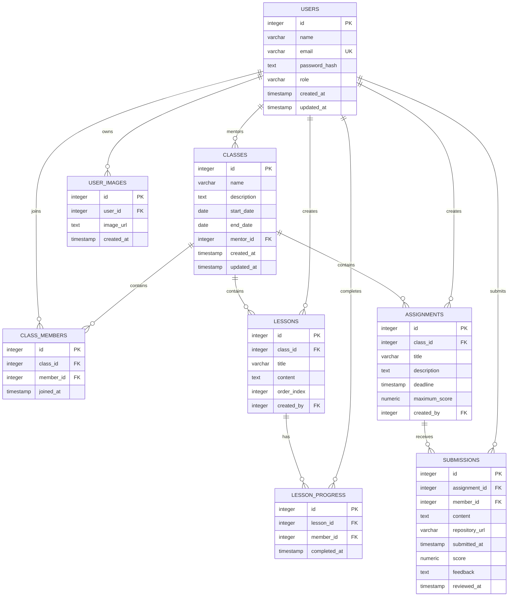

# S-Group Learning Platform — Backend

REST API cho nền tảng quản lý lớp học và quá trình học tập nội bộ S-Group. Dự án hiện dùng Node.js, Express 5, JavaScript ES modules và PostgreSQL.

## Tính năng

- Đăng ký Member, đăng nhập, JWT access/refresh token và xem profile.
- Admin quản lý user, class và membership.
- Mentor được gán quản lý lesson trong lớp; Member đã tham gia lớp xem lesson và theo dõi tiến độ.
- Upload và xóa ảnh qua Cloudflare R2.

Assignment, Submission, review, migration/seed và test tự động chưa được triển khai.

## Công nghệ

- Node.js 20 trở lên, npm
- Express 5, `express-validator`, `pg`
- PostgreSQL
- Cloudflare R2 (chỉ cần cho chức năng ảnh)

## Cài đặt và chạy

### 1. Cài dependencies

```bash
npm install
```

### 2. Cấu hình môi trường

Sao chép `.env.example` thành `.env` ở thư mục gốc rồi cập nhật cấu hình:

```dotenv
PORT=3000
NODE_ENV=development

# DATABASE_URL được ưu tiên nếu có; nếu không thì dùng DB_*.
DATABASE_URL=
DB_HOST=localhost
DB_PORT=5432
DB_USER=postgres
DB_PASSWORD=your-local-password
DB_NAME=sgroup

JWT_SECRET=replace-with-a-random-secret-at-least-32-bytes
JWT_REFRESH_SECRET=replace-with-a-different-random-secret-at-least-32-bytes
JWT_EXPIRES_IN=900
JWT_REFRESH_EXPIRES_IN=604800

# Chỉ cần khi sử dụng Cloudflare R2.
R2_ACCOUNT_ID=
R2_ACCESS_KEY_ID=
R2_SECRET_ACCESS_KEY=
R2_BUCKET_NAME=
R2_PUBLIC_URL=
```

Hai JWT secret phải khác nhau, mỗi secret dài ít nhất 32 byte. Thời hạn token tính bằng giây. Không commit `.env` hoặc chia sẻ secret thật.

### 3. Chuẩn bị database

Cần có PostgreSQL database với các bảng mà ứng dụng đang dùng: `users`, `classes`, `class_members`, `lessons`, `lesson_progress`, `user_images`. Repository hiện chưa có schema SQL, migration hoặc seed; hãy đối chiếu database với sơ đồ ERD dưới đây và các câu query trong `src/repository/`.

## ERD

Sơ đồ gồm các bảng đang được code sử dụng. `ASSIGNMENTS` và `SUBMISSIONS` là phần dự kiến, chưa triển khai.



## API chính đã triển khai

Các endpoint được mount từ `/`. Endpoint cần đăng nhập dùng header `Authorization: Bearer <accessToken>`.

| Nhóm | Endpoint | Quyền chính |
|---|---|---|
| Authentication | `POST /auth/register`, `POST /auth/login`, `POST /auth/refresh`, `GET /auth/me` | Register chỉ tạo Member; profile cần đăng nhập |
| User | `GET/POST /users`, `GET/PATCH/DELETE /users/:id` | Admin |
| Class | `GET /classes`, `GET /classes/:classId` | Admin xem tất cả; Member/mentor xem lớp có liên quan |
| Class | `POST /classes`, `PATCH/DELETE /classes/:classId` | Admin |
| ClassMember | `GET/POST /classes/:classId/members`, `DELETE /classes/:classId/members/:memberId` | Admin hoặc mentor xem danh sách; Admin thay đổi |
| Lesson | `GET/POST /classes/:classId/lessons`, `GET/PATCH/DELETE /lessons/:lessonId` | Mentor quản lý; mentor và Member đã tham gia xem |
| Progress | `POST /lessons/:lessonId/complete`, `GET /classes/:classId/progress` | Member đã tham gia lớp |
| Upload ảnh | `POST /upload/users/:id/image`, `POST /upload/users/:id/images`, `DELETE /upload/users/:id/images/:imageId` | Cloudflare R2 |

Upload ảnh hiện chưa được gắn authentication/authorization hoặc kiểm tra quyền sở hữu user ID. Chỉ sử dụng các endpoint này trong môi trường đáng tin cậy cho đến khi kiểm tra quyền được bổ sung. Mỗi file tối đa 5 MB; chấp nhận JPEG, PNG, WebP và GIF.

### 4. Chạy server

```bash
npm start       # Chạy server
npm run dev     # Chạy với node --watch
```

Mặc định API chạy tại `http://localhost:3000`. Server kiểm tra JWT config và kết nối PostgreSQL khi khởi động.

## Cấu trúc thư mục

```text
src/
├── config/       # PostgreSQL, biến môi trường, Cloudflare R2
├── controller/   # Nhận request và tạo response
├── core/         # Các loại lỗi API
├── middleware/   # Authentication, validation, upload, error handler
├── repository/   # Truy vấn PostgreSQL
├── route/        # Khai báo endpoint
├── service/      # Business logic và phân quyền theo resource
├── utils/        # JWT, password, response, async helper
├── app.js
└── index.js
```

## Scripts

| Lệnh | Mô tả |
|---|---|
| `npm start` | Chạy API |
| `npm run dev` | Chạy API ở chế độ watch |
| `npm test` | Gọi Node test runner; hiện repository chưa có test file |

## Trạng thái

Đã có authentication, User, Class, ClassMember, Lesson, LessonProgress và upload ảnh. Chưa có Assignment/Submission, kiểm thử tự động, OpenAPI/Swagger, Docker hoặc health endpoint. Không có tài khoản Admin mặc định; đăng ký công khai chỉ tạo Member, nên cần tạo Admin qua quy trình quản trị database đáng tin cậy.
